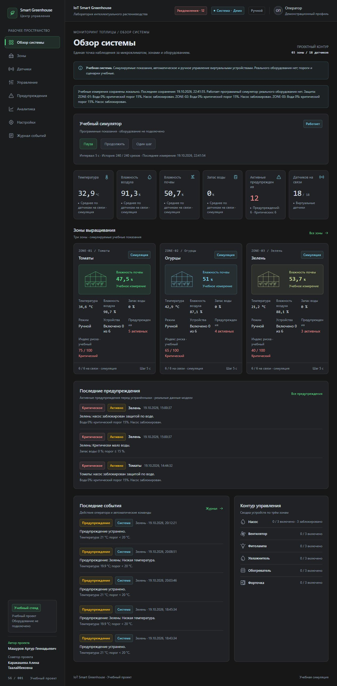
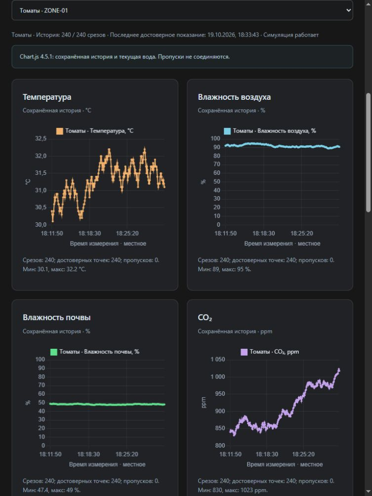
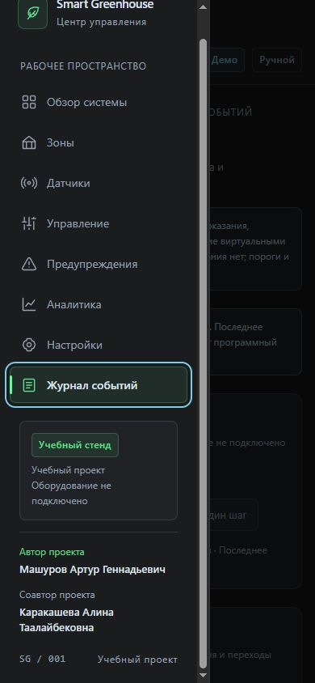

# IoT Smart Greenhouse

Многостраничная SCADA/IoT-панель для мониторинга теплицы: показания датчиков, управление микроклиматом, защитные ограничения и аналитика в одном интерфейсе.



**3 зоны · 18 датчиков · 18 исполнительных устройств · 8 разделов**

Это учебная программная симуляция. Все измерения и устройства виртуальные; реальное оборудование не подключено.

## Что делает система

Проект связывает наблюдение, управление и объяснение происходящего. Оператор видит состояние зон **«Томаты»**, **«Огурцы»** и **«Зелень»**, меняет настройки и прослеживает результат по показаниям, предупреждениям и журналу.

- **Мониторинг:** температура, влажность воздуха и почвы, освещённость, CO₂ и запас воды; время измерений и состояние связи датчиков.
- **Управление:** ручной и автоматический режимы каждой зоны, шесть типов устройств, настраиваемые пороги и защитные блокировки.
- **Демонстрация:** семь воспроизводимых сценариев, пауза, продолжение и один шаг симуляции. Обычный интервал — 5 секунд, настройка — от 3 до 10 секунд.
- **Аналитика:** пять графиков, индекс риска 0–100, поиск отклонений и рекомендации с обоснованием.
- **История:** активные и устранённые предупреждения, события оператора и автоматики, сохранение состояния в localStorage.

## Интерфейс

Графитовые поверхности, различимые статусы и отдельные цвета зон помогают читать состояние системы. На узком экране навигация открывается как боковая панель, а широкие таблицы прокручиваются внутри своих блоков.

<details>
<summary>Графики истории измерений</summary>



Четыре линейных графика используют накопленные измерения. Пятый, столбчатый график показывает текущий запас воды по зонам; недостоверные значения не подменяются примерами.

</details>

<details>
<summary>Боковая панель на мобильной ширине</summary>



</details>

## Архитектура и технологии

Приложение состоит из отдельных HTML-страниц с общей системой стилей и нативными JavaScript-модулями. Единое состояние связывает датчики, устройства, настройки и историю. Измерения и команды проходят через защитные проверки и правила управления, после чего обновляются представления и сохранённое состояние.

**HTML5 · CSS3 Grid/Flexbox · JavaScript ES modules · localStorage · Chart.js 4.5.1 · Git**

- `assets/js/` — модель, хранилище, симулятор, автоматика, защита, аналитика и представления.
- `assets/css/` — общая компоновка и компоненты интерфейса.
- `assets/vendor/chartjs/` — локальная библиотека графиков и лицензии.
- `tests/` — автоматические проверки; `docs/` — техническое руководство, иллюстрации и описание происхождения истории.

Backend, база данных и сборка не нужны. Локальный HTTP-сервер только раздаёт файлы, а логика выполняется в браузере. Последние показания, настройки, режимы, пауза и ограниченная история сохраняются в localStorage.

### Сторонние компоненты

Chart.js 4.5.1 включён локально и используется по [MIT-лицензии](assets/vendor/chartjs/LICENSE.md). В сборку входит `@kurkle/color` 0.3.2 с [собственной MIT-лицензией](assets/vendor/chartjs/LICENSE-color.md). При распространении необходимо сохранять оба текста лицензий и уведомления об авторских правах. [Сведения об источниках и версиях](assets/vendor/chartjs/SOURCE.json) находятся рядом с библиотекой.

## Восемь разделов

| Раздел | Назначение |
| --- | --- |
| [Обзор системы](index.html) | Сводные показатели, карточки зон, риски, устройства и последние предупреждения и события. |
| [Зоны](zones.html) | Сравнение трёх участков, поиск карточек и подробности выбранной зоны. |
| [Датчики](sensors.html) | Реестр измерений и времени обновления; поиск и фильтры зоны и связи. |
| [Управление](control.html) | Режим зоны, переключатели устройств, причины блокировок и учебные сценарии. |
| [Предупреждения](alerts.html) | Активные и устранённые нарушения с фильтрами зоны, уровня и состояния. |
| [Аналитика](analytics.html) | История, графики, индекс риска, отклонения и рекомендации. |
| [Настройки](settings.html) | Девять порогов каждой зоны, интервал симуляции и подтверждаемый сброс данных. |
| [Журнал событий](event-log.html) | Команды, защитные действия и изменения системы с фильтрами и показом записей порциями. |

## Быстрый запуск на Windows

Нужны современный браузер с JavaScript и Python 3 для локального сервера. Откройте PowerShell в папке проекта, рядом с `index.html`, и выполните:

```powershell
python -m http.server 8080 --bind 127.0.0.1
```

Откройте **[http://127.0.0.1:8080/](http://127.0.0.1:8080/)**. Терминал должен оставаться запущенным; остановка — **Ctrl+C**. Если порт занят, используйте уже работающий сервер этого проекта или другой свободный порт.

Можно также открыть проект через VS Code Live Server. Устанавливать пакеты приложения не требуется. Запуск двойным щелчком по HTML через `file://` не подходит для штатной работы ES-модулей.

### Размещение

Публичная история подготовлена из последовательных реальных этапов локального проекта с очисткой приватных данных. Это новые коммиты публичной редакции; исходная история сохранена отдельно. [Происхождение и соответствие этапов](docs/history.md).

Относительные пути позволяют разместить проект на GitHub Pages. После фактической публикации здесь будут добавлены адрес репозитория и проверенная ссылка на веб-версию. Сейчас публичные ссылки отсутствуют.

## Как увидеть работу автоматики

1. В разделе **«Управление»** выберите зону, установите **«Авто»** и нажмите **«Пауза»**.
2. Примените **«Сухая почва»**: сценарий задаст достаточный запас воды, и насос включится. **«Один шаг»** покажет влияние устройств на показания.
3. Примените **«Критически мало воды»**: насос будет заблокирован, а причина появится в предупреждениях и журнале.
4. Вернитесь в **«Ручной»**, включите, например, фитолампу и проверьте событие. Защита продолжает действовать и при ручном управлении.

Остальные пять сценариев — **«Перегрев»**, **«Холод»**, **«Недостаток света»**, **«Низкая влажность воздуха»** и **«Высокий CO₂»** — демонстрируют вентилятор, обогреватель, фитолампу, увлажнитель и форточку соответственно.

Насос не включается при критическом запасе воды или недостоверном датчике воды. В автоматическом режиме также нужны достоверные показания почвы. Вентилятор и обогреватель не работают одновременно; при автоматическом обогреве форточка закрыта. Пауза останавливает измерения, но не отключает защиту.

**«Восстановить учебные условия»** возвращает опорные показания зоны, сохраняя режим, настройки и историю. Это не сброс данных. Сценарии изменяют учебные показания и пополняют историю; при крайних порогах некоторые сценарии могут быть недоступны.

## Проверки

**Последний полный прогон — 238/238 тестов, без ошибок и пропусков (19.10.2026).** Набор охватывает модель, хранение, симуляцию, управление, защиту, предупреждения, журнал, формы, фильтры и аналитику.

Для запуска нужен Node.js с поддержкой встроенного `node:test`; установка пакетов не требуется:

```powershell
node --test tests/*.test.mjs
```

Первоначальная браузерная приёмка охватила восемь страниц на четырёх ширинах: 1920, 1366, 768 и 390 px. После русификации и добавления авторства выполнены повторные проверки на 1366, 768 и 390 px. Они подтвердили основные переходы, адаптивную компоновку, работу меню и уведомлений; в доступных чтениях Console ошибок не обнаружено.

Это не исчерпывающая проверка всех браузеров, устройств и способов взаимодействия. [Точный объём проверок и ограничения](docs/technical-guide.md#браузерная-приёмка) сохранены в техническом руководстве.

## Границы учебной модели

Система не управляет настоящими устройствами. Показания, влияние оборудования и пороговые значения предназначены для демонстрации программной логики, а не для промышленной эксплуатации или точного моделирования выращивания.

Индекс риска — объяснимая эвристическая оценка. Рекомендации не переключают устройства, не заменяют агронома и не гарантируют результат. При неполных данных система не выдаёт низкое число за подтверждение безопасности.

Данные остаются в браузере; синхронизации нескольких активных вкладок нет. Для демонстрации используйте одну вкладку. Правила хранения, лимиты истории, обработка ошибок и подробные сценарии описаны в [техническом руководстве](docs/technical-guide.md).

## Авторство

**Автор:** Машуров Артур Геннадьевич

**Соавтор:** Каракашева Алина Таалайбековна
